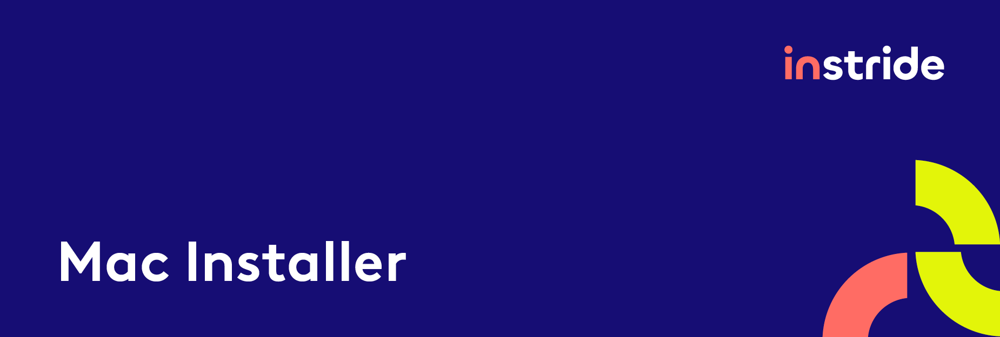

Automatically installs all the Apps and configurations you will need for your
journey at instride / Woche-Pass AG.

This script is meant to automate some parts of the onboarding,
so by design this is very opinionated.

## 💾 Download
- Get the files [here](https://github.com/instride-ch/MacInstaller/archive/refs/heads/main.zip)
  and extract them, or clone the repository. Any location works.

## ⏱ Preparation
- Sign into the Apple App Store GUI manually
- Make sure you can reach the network share `smb://fs03.wopa.int/recycling` (office network or VPN)

## 💻 Installation
- Open the Terminal app
- Type `bash <path-to-folder>/install.sh`, e.g. `bash ~/Downloads/MacInstaller-main/install.sh`
- Hit the [ENTER ↵] key
- Follow the instructions in the terminal. **You will be prompted for your system password**
- At the end the script lists manual steps and opens the folder `ToInstall` with software to install by hand
- Everything is logged to `install.log` in the same folder

Apps that are already installed are detected and skipped, so the script can be run again.

## 👥 Roles

| Role            | Brewfiles                                   | Extras                                   |
|-----------------|---------------------------------------------|------------------------------------------|
| WoPa – Dispo    | `Brewfile`, `Brewfile.wopa_dispo`           | –                                        |
| WoPa – Vorstufe | `Brewfile`, `Brewfile.wopa_vorstufe`        | Adobe / prepress software from the share |
| instride – PL   | `Brewfile`, `Brewfile.instride`, `Brewfile.instride_pl`  | Git setup                   |
| instride – Dev  | `Brewfile`, `Brewfile.instride`, `Brewfile.instride_dev` | Git setup, nvm + Node LTS, developer settings |
| instride – UX   | `Brewfile`, `Brewfile.instride`, `Brewfile.instride_ux`  | Git setup, nvm + Node LTS, developer settings |

Role settings live in `roles/`, shared logic in `lib/`.

## 🔄 Update
Choose `(6) Update` in the menu or run `bash update.sh`.

## ↩️ Revert
Choose `(7) Revert` in the menu to undo the changes of the installer:
macOS settings, Gatekeeper, `~/Brewfile`, nvm / Node.js versions, git identity, SSH config
(the SSH key only after confirmation) and the `ToInstall` folder.

Brew packages and the Homebrew PATH entry in `~/.zprofile` stay installed.
The original state is recorded in `~/.macinstaller/` on the first installer run.
